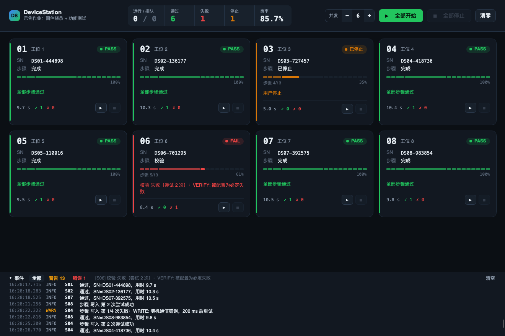

# DeviceStation

多设备并行作业框架：一台上位机同时对很多台设备跑同一套作业，每台**独立运行、独立停止、独立出结果**，一台出问题不影响其它台。
仓库自带两个示例作业（固件烧录、功能测试）和模拟设备，不接硬件也能直接演示。



## 特性

- **步骤式作业**：每步可配超时和重试，长步骤重试时从断点续做
- **隔离**：每台设备独立的任务、`CancellationTokenSource` 和通道；失败、超时、停止都只影响自己
- **并发上限**：`SemaphoreSlim` 控制同时运行的台数，其余排队（排队中也能停止）
- **通道**：串口、TCP、模拟设备，全部可取消
- **记录**：日志带 DeviceId 作用域；结果按 SN 写入 SQLite（后台批量写，不阻塞设备）
- **界面**：Avalonia 卡片墙，分段步骤轨显示每台走到哪一步；100 ms 节流刷新，无阻塞弹窗

## 运行

```bash
dotnet run --project src/DeviceStation.App -- --autostart
```

```bash
dotnet test
```

参数：`--autostart` 启动即全部开始，`--max-concurrency <n>` 并发上限，`--data <目录>` 数据目录，`--firmware <文件>` 示例烧录用的固件。
目标框架 `net8.0`，设置了 `RollForward=Major`，只装 .NET 9/10 运行时也能跑。

## 结构

```
src/DeviceStation.Core     纯类库，不依赖 UI
  Channels/   IDeviceChannel：Serial / Tcp / Simulated
  Devices/    工位配置（每工位一个 JSON）、DeviceSession、快照
  Jobs/       IJobStep、StepPolicy、IJob、StepRunner（超时/重试）、DeviceContext
    Examples/ 示例作业：FlashJob（固件烧录）、TestJob（上下限测试）
  Execution/  DeviceManager：StartAll / StopAll / Start(id) / Stop(id)
  Results/    SqliteResultStore
src/DeviceStation.App      Avalonia 11 + CommunityToolkit.Mvvm
tests/                     xUnit，基于模拟设备
.superdesign/              界面设计稿（3 个方向，采用 station_1）
```

## 几个关键做法

- **超时 vs 停止**：每次尝试用一个链接到设备 CTS 的 CTS 并 `CancelAfter`，据此区分“超时→重试”和“用户停止→立即结束”。
- **串口读不响应取消**：后台读循环把数据放进 `Channel<byte[]>`，业务只等这个队列，所以总能取消。
- **作业共享、状态隔离**：一个作业实例服务所有设备（示例固件只加载一次，`ReadOnlyMemory<byte>` 切片共享），每台设备的状态放在 `DeviceContext`。
- **先释放再报完成**：关闭通道、归还名额之后才切到终态，看到 PASS 立刻重开不会撞上端口占用。
- **重试前清接收缓冲**：命令超时后设备的迟到响应可能已经进了通道队列，重试前用 `DiscardInput()` 清掉，避免把它当成新命令的响应。
- **坏配置只影响自己**：某个工位 JSON 损坏或 Id 重复时跳过并记错误日志，其它工位照常加载。

## 接入自己的场景

实现 `IJobStep`（或用 `DelegateStep`）组成 `Job`，在 `App.axaml.cs` 里替换示例作业；把工位 JSON 的 `channel` 改成真实设备：

```json
{ "id": "S01", "name": "工位 1", "channel": { "kind": "serial", "portName": "/dev/tty.usbserial-1410", "baudRate": 115200 } }
```
